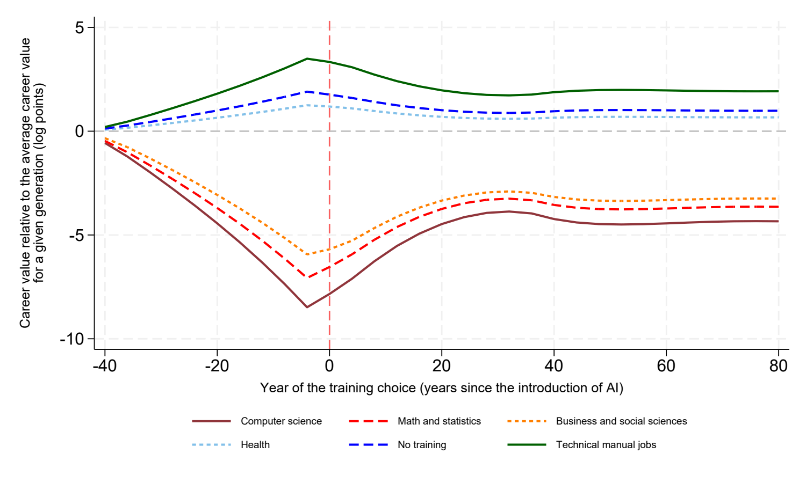
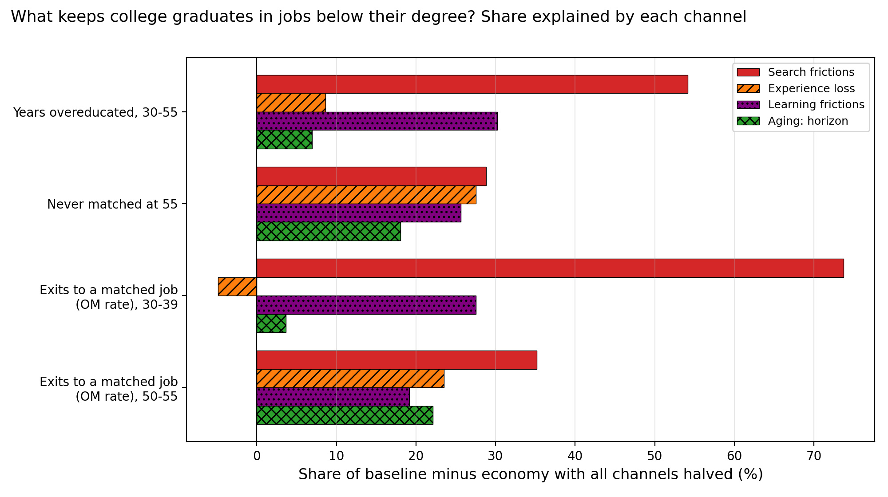

<ul class="publication-list">
  
  <li class="publication-item" style="margin-top: 30px; display: flex; gap: 20px; align-items: flex-start;">
    <!-- Contenuto a sinistra -->
    

      <h3 class="publication-title" style="margin-bottom: 5px;">
        Investments in Human Capital in the Age of AI
      </h3>
      
Aleandro Palazzo

      

        <a href="/assets/draft_AI_human_capital.pdf" target="_blank" style="margin-right: 10px;">[Draft]</a>
      

      

        
Abstract

        

          How does generative AI change the educational choices of new generations, and how do these choices 
    shape its effects on wages? I study these questions in an overlapping-generations, task-based model 
    in which each student makes an irreversible choice among 13 training fields. I measure field-level 
    AI shocks using task-level theoretical exposure and current use, and calibrate the model to 
    the US labor market. In the long run, workers move away from the fields most exposed to automation, 
    with computer science employment falling by 14.3%. This labor reallocation absorbs about 70% of 
    AI's direct impact on relative wages. However, adjustment takes decades. Workers who trained in the 
    most exposed fields just before AI's introduction bear the largest relative losses, whereas gradual 
    reallocation mitigates the impact on future generations. Early enrollment data are consistent with 
    the model's quantitative implications: computer science enrollment fell by 8.1% in fall 2025, against 
    a predicted 7%. 
        

      

    

    <!-- Immagine a destra -->
    
  </li>

  <li class="publication-item" style="margin-bottom: 30px; display: flex; gap: 20px; align-items: flex-start;">
    <!-- Contenuto a sinistra -->
    

      <h3 class="publication-title" style="margin-bottom: 5px;">
        Overeducation Persistence Over the Lifecycle: Disentangling Frictions, Specialization and Aging
      </h3>
      

        Aleandro Palazzo
      

      

        <a href="/assets/draft_overeduc.pdf" target="_blank" style="margin-right: 10px;">[Draft]</a>
      

      

        
Abstract

        

          Between 20\% and 35\% of workers are overeducated: they hold more education than the typical 
requirement of their job. The monthly rate at which overeducated U.S.\ college graduates move to 
a matched job that requires their degree falls by almost two thirds between their thirties and their fifties. 
Moreover, among graduates who are overeducated at age 30, one in four has never moved to a matched job by 
age 55. I study these facts with a lifecycle directed-search model in which graduates differ by field of 
study and accumulate field-specific experience that is only partly transferable between non-college 
and college jobs, firms and workers learn about match quality over time, and the work horizon shortens 
with age. Calibrated to the NLSY79, the model reproduces the profile of the hazard rate of exits by age. 
Search and learning frictions account for most of the time that
graduates spend overeducated, especially early in the career. Late in the career
the partial loss of experience and the shrinking work horizon account for almost half of overeducation persistence.
        

      

    

    <!-- Immagine a destra -->
    
  </li>
</ul>
<h2 style="margin-top: 50px;">Work in Progress</h2>

<ul class="publication-list">
  <li class="publication-item" style="margin-bottom: 20px;">
    <h3 class="publication-title" style="margin-bottom: 5px;">AI and Labor Market Rigidity: Implications for Human Capital</h3>
    
Aleandro Palazzo

  </li>

  <li class="publication-item" style="margin-bottom: 20px;">
    <h3 class="publication-title" style="margin-bottom: 5px;">Is AI Unsorting the Labor Market?</h3>
    
Aleandro Palazzo

  </li>
</ul>
