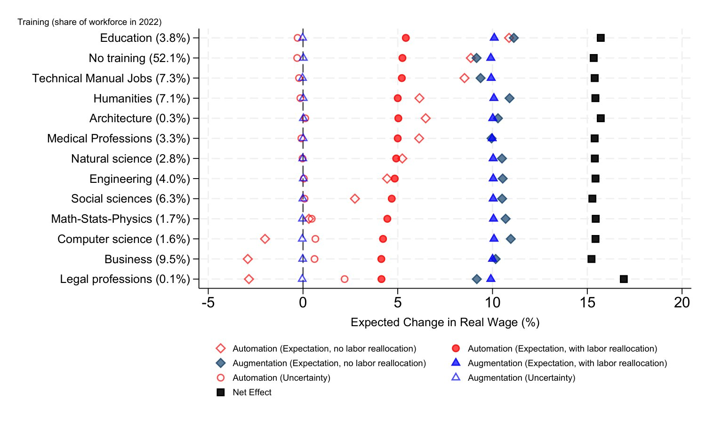
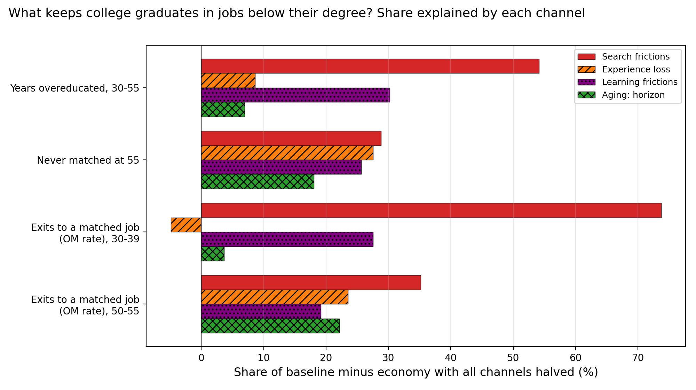

<ul class="publication-list">
  
  <li class="publication-item" style="margin-top: 30px; display: flex; gap: 20px; align-items: flex-start;">
    <!-- Contenuto a sinistra -->
    

      <h3 class="publication-title" style="margin-bottom: 5px;">
        Investments in Human Capital in the Age of Artificial Intelligence
      </h3>
      
Aleandro Palazzo

      

        <a href="/assets/draft_AI_human_capital.pdf" target="_blank" style="margin-right: 10px;">[Draft]</a>
        <a href="/assets/AI_education_slides.pdf" target="_blank" style="margin-right: 10px;">[Slides]</a>
      

      

        
Abstract

        

          How does Artificial Intelligence reshape human capital investment decisions? I develop a task-based
    model where risk-averse agents make irreversible training choices based on AI's expected impact and uncertainty.
    Calibrated to the US labor market, the framework decomposes AI shocks into expected automation, expected
    augmentation, and their associated uncertainties. The model yields three key results.
    First, expected automation drives a structural reallocation, causing young students to systematically avoid training
    paths facing high automation risk, while choosing paths requiring more manual or social skills. Second, 
    average expected wages rise, but their distribution depends on the 
    responsiveness of training choices made by the new generation: when it is high, labor scarcity
    offsets the direct impact of AI and wage gains are nearly uniform across training paths; when it is low, labor reallocation 
    is weaker, and wage gains are more concentrated in the safest paths. Third, automation uncertainty generates an endogenous 
    risk premium.
        

      

    

    <!-- Immagine a destra -->
    
  </li>

  <li class="publication-item" style="margin-bottom: 30px; display: flex; gap: 20px; align-items: flex-start;">
    <!-- Contenuto a sinistra -->
    

      <h3 class="publication-title" style="margin-bottom: 5px;">
        Overeducation Persistence Over the Lifecycle: Disentangling Frictions, Specialization and Aging
      </h3>
      

        Aleandro Palazzo
      

      

        <a href="/assets/draft_overeduc.pdf" target="_blank" style="margin-right: 10px;">[Draft]</a>
      

      

        
Abstract

        

          The monthly persistence of overeducation among U.S. college graduates rises steadily with age, and among graduates
who are overeducated at age 30, most reach a job that requires a degree within a few years, but one in six has not
reached one by age 55. I study these facts with a lifecycle directed-search model in which graduates differ by field
of study and accumulate field-specific experience that is only partly transferable between non-college and college
jobs, firms and workers learn about match quality over time, and the work horizon shortens with age. Calibrated to
the NLSY79, the model reproduces the untargeted rise of persistence with age and the speed of the early exits from
overeducation. Search and learning frictions account for most of the time that graduates spend overeducated, while
the partial loss of experience and the shrinking work horizon account for the rise of persistence with age.
        

      

    

    <!-- Immagine a destra -->
    
  </li>
</ul>
<h2 style="margin-top: 50px;">Work in Progress</h2>

<ul class="publication-list">
  <li class="publication-item" style="margin-bottom: 20px;">
    <h3 class="publication-title" style="margin-bottom: 5px;">AI and Labor Market Rigidity: Implications for Human Capital</h3>
    
Aleandro Palazzo

  </li>

  <li class="publication-item" style="margin-bottom: 20px;">
    <h3 class="publication-title" style="margin-bottom: 5px;">Is AI Unsorting the Labor Market?</h3>
    
Aleandro Palazzo

  </li>
</ul>
